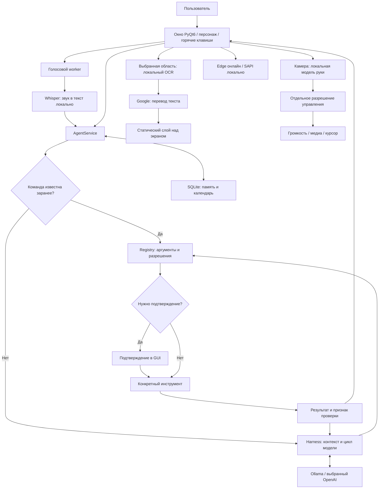

# Eidos: полный аудит проекта

Дата: **13 октября 2026**, часовой пояс Asia/Bishkek. Проверена рабочая папка `C:\Users\Элдос\Desktop\Eidos`, включая незакоммиченные изменения. База Git: `6d786b79ecb9c75b5ece33bbcd60567fc8aa0179`, ветка `codex/background-voice`, версия приложения `0.1.0`.

## 1. Что это за проект

**Eidos — настольный персональный помощник для Windows.** Он объединяет разговор с языковой моделью, голосовые команды, перевод выбранной области экрана, управление рукой через камеру, локальную память, календарь и ограниченный набор действий на компьютере.

Ценность проекта — соединение этих возможностей в одном интерфейсе с персонажем, голосом, горячими клавишами и понятными состояниями работы. Собственная обученная нейросеть здесь не создаётся: Eidos использует готовые модели и библиотеки, а собственный код отвечает за их взаимодействие, интерфейс и ограничения действий.

По моей оценке, это **работающий прототип / ранняя версия продукта**: основные сценарии реализованы, имеется большая тестовая база, приложение запускается и собирается. До готовности к массовому распространению остаются вопросы приватности, поставки зависимостей, лицензий, устойчивости и ясности обещаний продукта.

Для быстрого знакомства прочитайте разделы 2–5, затем таблицу проблем в разделе 9 и план в разделе 14.

### Важное разделение: Eidos и JARVIS

В репозитории лежит отдельная папка `JARVIS-main`. Это другой проект со своим запуском, зависимостями, облачным Gemini, инструментами и лицензией. По найденным импортам и конфигурации упаковки **штатный `python -m eidos` не подключает JARVIS**. Собранный wheel Eidos также не содержит JARVIS.

Некоторые имена адаптеров и документов упоминают JonSnow/JARVIS, но это не означает, что весь исходный JARVIS работает внутри Eidos. Например, `JonSnowTranslator` — собственный адаптер OCR/перевода в пакете Eidos.

Нельзя переносить возможности или уязвимости JARVIS на Eidos без проверки конкретного пути исполнения. Риски исходного JARVIS рассмотрены отдельно в разделе 10.

## 2. Что действительно настроено сейчас

Это результаты чтения технических настроек на компьютере, а не значения из README. Ключи и содержимое памяти не читались. Личные тексты и имена профилей в отчёт не включены.

| Компонент | Фактическое состояние | Что это означает |
|---|---|---|
| ОС и runtime | Windows, Python 3.11.17, локальная `.venv` | Запуск зависит от подготовленного Python-окружения |
| Интерфейс | PyQt6 6.11.0 | Нативное настольное приложение, без браузерного frontend |
| LLM-провайдер | Ollama 0.40.2 | Разговор с моделью идёт в локальный сервис |
| Адрес сервиса | `127.0.0.1:11434` | Проверенный listener доступен на loopback, не на всех сетевых интерфейсах |
| Установленная модель | `qwen3:4b-instruct-2507-q4_K_M` | Около 4 млрд параметров, квантизация Q4_K_M; файл модели ≈2.33 GiB |
| Контекст в настройках | **2048 токенов** | Пример конфигурации и README упоминают 4096, но текущая настройка меньше |
| Распознавание речи | Whisper `base`, `cpu` | GPU используется локальной LLM, но STT в текущем профиле работает на CPU |
| Озвучка | Edge TTS, `ru-RU-DmitryNeural`, включена | Для синтеза нужен интернет; текст передаётся внешнему сервису |
| Активация словом | Включена в JSON, `pvporcupine` не установлен, файлы `.ppn` и `.pv` не готовы | Сохранённая галочка не соответствует готовности функции |
| Постоянная память | Включена | Диалоги и итоги могут сохраняться в SQLite |
| Поиск | Brave | Для результатов через API требуется ключ; его наличие и реальная работа не проверялись |
| Telegram / Discord | Оба выключены, списки доступа пусты | Удалённые каналы сейчас не активны |
| Удалённые Windows-разрешения | Пустой список | По умолчанию бот не получает управление компьютером |
| Разрешённые приложения | 1 запись | Список конкретных EXE задаёт пользователь |
| Жесты | Режим auto, целевые 15 FPS | Это параметры; включённая камера в момент аудита не подтверждалась |
| Плавающий персонаж | Включён | Настольный режим доступен по текущим настройкам |
| Закрытие в трей | Выключено | Параметр `close_to_tray=false` |

Перед тестовой генерацией `/api/ps` не показывал загруженных моделей: **сервис был запущен, но модель ещё не находилась в рабочей памяти**. Установленная модель, подключённый сервис и работающий ответ — три разных состояния.

### Проверка модели на этом компьютере

Проверены два искусственных запроса без профиля, памяти и документов пользователя:

| Проверка | Результат |
|---|---|
| Короткое приветствие | «Здравствуйте!», **9.594 с**; из них загрузка модели ≈8.94 с |
| Запрос вызова `calendar_list` | Модель вернула корректное имя и пустой объект аргументов, **0.875 с** |
| Память модели после запросов | Ollama сообщил `size_vram=2 874 062 929` байт, ≈**2.68 GiB VRAM**, контекст 2048 |

Вызов календаря был только предложением модели: инструмент в этой проверке не исполнялся. Это подтверждает ответы и basic tool calling, но не точность всех бытовых задач. Два запроса не являются статистическим benchmark.

На компьютере 15.73 GiB RAM и 12 логических CPU. При последнем снимке перед генерацией свободно было около 1.39 GiB RAM; в разных проверках значение менялось. Ранее сохранённая диагностика проекта указывает i5-12450HX и RTX 3050 Laptop 6 GB. Эти названия оборудования взяты из исторического файла; текущий GPU offload подтверждён отдельно ответом Ollama.

Доказательства: [технический снимок](<C:/Users/Элдос/Desktop/Eidos/docs/audit-2026-10-13/evidence.json>), [проба локальной модели](<C:/Users/Элдос/Desktop/Eidos/docs/audit-2026-10-13/local-model-probe.json>), [историческая диагностика](<C:/Users/Элдос/Desktop/Eidos/docs/hardware.json>).

## 3. Из чего состоит приложение

| Слой | За что отвечает | Главные файлы |
|---|---|---|
| Вход в программу | Аргументы запуска, Qt event loop, smoke-test | [__main__.py](<C:/Users/Элдос/Desktop/Eidos/eidos/__main__.py:11>) |
| Базовая логика | Конфигурация, языки, команды, состояния, горячие клавиши | [config.py](<C:/Users/Элдос/Desktop/Eidos/eidos/core/config.py:12>) |
| Интерфейс | Окно, страницы, персонаж, боковое меню, настройки | [main_window.py](<C:/Users/Элдос/Desktop/Eidos/eidos/ui/main_window.py:36>) |
| Связь UI и агента | Запросы, подтверждения, выбор файлов, напоминания, polling ботов | [assistant_bindings.py](<C:/Users/Элдос/Desktop/Eidos/eidos/ui/assistant_bindings.py:42>) |
| Агентский сервис | Профиль, история, память, выбор провайдера, сериализация задач | [service.py](<C:/Users/Элдос/Desktop/Eidos/eidos/agent/service.py:18>) |
| Контроль инструментов | Проверка аргументов, разрешений, подтверждений, лимита шагов | [harness.py](<C:/Users/Элдос/Desktop/Eidos/eidos/agent/harness.py:83>) |
| Адаптеры моделей | HTTP к Ollama или OpenAI | [providers.py](<C:/Users/Элдос/Desktop/Eidos/eidos/agent/providers.py:32>) |
| Инструменты | Документы, календарь, публичные страницы, приложения, звук Windows | [tools.py](<C:/Users/Элдос/Desktop/Eidos/eidos/agent/tools.py:355>) |
| Голос | Запись, STT, активация, озвучка и воспроизведение | [voice/controller.py](<C:/Users/Элдос/Desktop/Eidos/eidos/modules/voice/controller.py:14>) |
| OCR и перевод | Windows OCR, Tesseract, Google translation | [ocr/engine.py](<C:/Users/Элдос/Desktop/Eidos/eidos/modules/ocr/engine.py:23>) |
| Камера и жесты | Захват кадров, MediaPipe, распознавание руки, Windows actions | [vision/service.py](<C:/Users/Элдос/Desktop/Eidos/eidos/modules/vision/service.py:80>) |
| Данные | SQLite FTS5, JSON-профили и Windows Credential Manager | [memory.py](<C:/Users/Элдос/Desktop/Eidos/eidos/agent/memory.py:28>), [secrets.py](<C:/Users/Элдос/Desktop/Eidos/eidos/agent/secrets.py:5>) |

### Карта взаимодействия



## 4. Как проходит обычная задача

### Текст и действия компьютера

1. Пользователь вводит запрос в диалоге.
2. AgentController передаёт работу в QThread. Операции модели и сети не должны блокировать основной UI-поток.
3. AgentService проверяет запрос на известные секреты и занимает lock: одновременно выполняется одна агентская задача.
4. Простые команды вроде «Сделай громкость 30 процентов» распознаются правилами. Языковая модель для них не нужна.
5. Для остальных запросов формируется контекст: системные инструкции, релевантная память, профиль, выбранные файлы и короткая история.
6. Модель либо отвечает текстом, либо предлагает вызовы инструментов. Harness допускает до 8 шагов и до 4 вызовов в одном ответе.
7. Registry проверяет имя инструмента, точный набор аргументов, типы, диапазоны, разрешения и необходимость подтверждения.
8. Инструмент возвращает текст и `verified`. Отрицательный результат не превращается в «успешно» только потому, что модель так написала.
9. При включённой памяти и обычном локальном диалоге сохраняются разговор и краткий итог.

Отмена **кооперативная**: она останавливает следующую операцию в точках проверки. Уже выполненные действия не откатываются. Это не транзакция всего разговора.

### Голос

Микрофон → локальная запись → преобразование в mono 16 kHz → Faster-Whisper → текст → агент / команда интерфейса → текст ответа → общая очередь озвучки → QtMultimedia.

В основном GUI непрерывный голос включается runtime-переключателем `listen_enabled`. Поэтому сохранённое `continuous_listening=false` само по себе не доказывает, что пользователь не включал непрерывный режим кнопкой. Состояние активного окна в момент аудита не считывалось.

STT по умолчанию русскоязычный: в коде передаётся `language='ru'`. На CPU используется предпочтительно int8, на CUDA — float16, если доступен нужный compute type. Первая загрузка Whisper требует сети, повторная сначала использует локальный кеш.

Активация словом в основном приложении реализована через Porcupine. Для неё требуются отдельный пакет, AccessKey и модели. Экспериментальный `local_input.py` с Silero/openWakeWord и push-to-talk используется отдельным demo-скриптом, **не основным MainWindow**. Его наличие в репозитории не означает готовую замену текущей активации.

В GUI стандартная озвучка проходит через SpeechQueue: основной voice worker запускается с `speak=False`, затем общий слой воспроизводит ответ. Это предотвращает двойную озвучку.

### Перевод

Пользователь явно выбирает область одного экрана. OCR получает изображение локально. При необходимости скачивается языковая модель Tesseract. Затем распознанные строки отправляются Google, и перевод размещается поверх снимка в исходных координатах.

Слой статический и пропускает клики. Он не следит за движением окна или прокруткой; после изменений требуется обновление области. Исправленный текст можно перевести отдельно. Заявленные 67 языков — каталог моделей/направлений, а не проверенная одинаковая точность на каждом языке.

### Жесты

OpenCV получает кадры камеры; MediaPipe Hand Landmarker распознаёт ключевые точки руки; GestureEngine преобразует положения в команды. Захват, распознавание и GUI разделены. Передаётся последний свежий кадр, что предотвращает накопление очереди.

Управление включается отдельно от камеры. Для него требуется доступная аварийная горячая клавиша. ControlGate повторно проверяет разрешение, поколение настроек и свежесть кадра непосредственно перед действием. При потере руки/свежего кадра действия останавливаются.

Реализованы громкость, media play/pause и перемещение курсора. Анализ сцены, понимание произвольных объектов, распознавание человека и полноценное управление произвольным интерфейсом отсутствуют.

## 5. Что умеет, а где есть ограничения

| Функция | Реализация | Практическая граница |
|---|---|---|
| Диалог | Ollama, опционально OpenAI | Модель может ошибаться; содержательное качество широким benchmark не измерено |
| Громкость и mute | Windows Core Audio / pycaw | Проверяются чтением значения после изменения |
| Запуск приложений | Блокнот, выбранные EXE, Windows Settings | Процесс запущен ≠ нужное окно действительно появилось |
| Веб | Открытие браузера, чтение публичной HTML/text страницы, Brave API | DuckDuckGo/Bing открывают поиск, но не возвращают результаты агенту |
| Программирование | Объяснение и подготовка кода | В текущем Eidos нет произвольного инструмента исполнения кода |
| Работа с документами | TXT, MD, DOCX, XLSX, PDF | Новая версия не сохраняет форматирование исходника |
| Чтение документов | До 10 MB файла; результат до 12 000 символов | XLSX: до 5 листов, 200 строк, 30 столбцов; PDF: первые 20 страниц |
| PDF | Извлечение текстового слоя и простой текстовый PDF | Сканированные PDF этим инструментом не распознаются |
| XLSX | Чтение значений, создание таблицы из TSV | Новые ячейки записываются как строки; формулы и стили не сохраняются |
| Календарь | Локальные события с UTC и IANA timezone | Внешней синхронизации нет; напоминания только при работающем Eidos |
| Память | SQLite FTS5, редактирование, удаление | Это поиск по словам, не обучение модели и не семантическая память |
| Профили | Ручной выбор, отдельные файлы/БД | Это не разные Windows-пользователи и не распознавание владельца по голосу |
| Боты | Telegram / Discord REST, polling | Списки user AND channel, ручное подтверждение ответов, без работы с локальными файлами |
| Skills | Каталог возможностей и требований | Метаданные; не механизм загрузки сторонних исполняемых навыков |
| Фото, дизайн, 3D | Советы модели | Автоматического редактирования фото/3D-сцен нет |
| Интерфейс | 8 основных разделов, персонаж, компактный режим, трей | Светлая тема, автозапуск и многоязычный UI не являются готовыми функциями |

Текущий `camera_status` ещё говорит, что распознавание жестов недоступно, хотя основной модуль жестов реализован. Это несогласованность текста инструмента с продуктом, а не отсутствие всей функции.

## 6. На каких технологиях всё работает

| Назначение | Технологии | Установленные версии основных компонентов |
|---|---|---|
| UI | Python, PyQt6, Qt Widgets / Multimedia, QThread | Python 3.11.17; PyQt6 6.11.0 |
| LLM | Ollama HTTP API, Qwen GGUF, GPU offload | Ollama 0.40.2; Qwen 4B Q4_K_M |
| STT | Faster-Whisper, CTranslate2, NumPy, sounddevice | 1.2.1; 4.8.2; 2.4.6; 0.5.6 |
| TTS | edge-tts или Windows SAPI через COM | edge-tts 7.2.8 |
| Wake word | pvporcupine | Сейчас отсутствует |
| OCR | Windows WinRT OCR, Tesseract / tesserocr, Pillow | tesserocr 2.10.0; Pillow 12.3.0 |
| Камера | MediaPipe, OpenCV contrib, enumerator | MediaPipe 1.1.0; OpenCV contrib 4.14.0.94 |
| HTTP | httpx, urllib, http.client | httpx 0.28.1 |
| Документы | python-docx, openpyxl, pypdf, ReportLab | pypdf 6.20.0; ReportLab 4.5.1 |
| Данные | SQLite и FTS5, JSON | Встроенная SQLite в runtime |
| Секреты | keyring WinVaultKeyring | keyring 25.7.0 |
| Проверки | pytest | pytest 9.1.1 |
| Сборка | setuptools / wheel, pyproject.toml | Python wheel; готовый EXE-installer не найден |

Поддержка Python объявлена как `>=3.11,<3.13`. Основной целевой сценарий — Windows. Прямые tesserocr wheel привязаны к Windows AMD64 и Python 3.11/3.12; это не универсальная установка на любую ОС/архитектуру.

React, Next.js, Node backend, Supabase, PostgreSQL и Docker не входят в рабочую архитектуру Eidos. Основной runtime и данные находятся на компьютере пользователя.

Полный локальный список версий: [packages.json](<C:/Users/Элдос/Desktop/Eidos/docs/audit-2026-10-13/packages.json>).

## 7. Где данные и что выходит в сеть

Стандартная папка данных: `%LOCALAPPDATA%\Eidos`. Её можно переопределить `EIDOS_DATA_DIR`. Для дополнительных профилей используется подпапка с hash имени, что предотвращает выход пути за корень профилей.

| Данные | Где находятся | Особенности |
|---|---|---|
| Параметры UI и голоса | `config.json` | JSON, атомарная запись через временный файл и replace |
| Модель, профиль, разрешения | `agent.json` | Имя и задачи профиля хранятся в обычном JSON |
| Выбор профиля | `profiles.json` | Основной профиль — корневая папка; дополнительные — отдельные папки |
| Память, события, доставки | `memory.sqlite` | Таблицы memories, FTS, events, deliveries |
| API-ключи и bot tokens | Windows Credential Manager, сервис `Eidos/assistant` | Нет автоматического plaintext fallback |
| Whisper | Папка моделей в данных приложения | Первая загрузка из Hugging Face |
| OCR-модели | `ocr-models` | Загружаются из tessdata_fast |
| Portable Ollama и модели | `.tools/ollama`, `.cache/ollama-models` в рабочем проекте | Наличие проверяемых файлов не означает, что именно этот binary запустил текущий daemon |
| Озвучка | Временные MP3/WAV | Обычно удаляются; crash-cleanup старых временных файлов не найден |
| Выбранные файлы и папки | В оперативном состоянии AgentService | Разрешение действует до очистки/смены профиля/завершения, не только на одну реплику |

### Потоки наружу

| Получатель | Что отправляется | Когда |
|---|---|---|
| Локальный Ollama | Запрос, профиль, найденная память, история, данные инструментов | При локальном LLM-диалоге |
| OpenAI | Аналогичный выбранный контекст | Только при переключении LLM-провайдера на OpenAI |
| Google Translate | Распознанный или введённый текст; параметр `q` в URL | При онлайн-переводе |
| Edge TTS | Текст для синтеза | При выбранном Edge TTS |
| Brave | Поисковый запрос | При Brave API search |
| DuckDuckGo / Bing | Поисковый запрос в URL браузера | При выбранном browser search |
| Telegram / Discord | Текст сообщений и ответов | Только при включённых ботах |
| Hugging Face / GitHub / Google Storage | Запросы скачивания моделей | При первой подготовке нужных моделей |

Скриншот для текущего перевода не отправляется Google как изображение: сначала локальный OCR извлекает текст. Но сам текст может содержать личные сведения. «Локальная LLM» не превращает перевод и Edge-озвучку в офлайн-функции.

«Разговор без сохранения» отключает использование FTS/истории и запись новых сообщений. Профиль в настройках остаётся отдельным источником контекста. Это режим без сохранения разговора, не гарантированная анонимность и не блокировка интернета.

Ключи общие для сервиса Eidos в Windows Credential Manager: профили разделяют SQLite/JSON, но не создают независимые vault-аккаунты. Другой процесс с правами этого Windows-пользователя остаётся вне защитной границы приложения.

## 8. Что в безопасности сделано правильно

1. В текущем Eidos нет инструмента произвольного исполнения Python или shell-команды модели. EXE запускаются списком аргументов и только из выбранного списка.
2. Инструменты имеют схемы аргументов. Запрещены лишние поля, неверные типы, bool вместо числа и значения вне диапазонов.
3. Удалённые каналы по умолчанию выключены. Для входящих сообщений одновременно требуются разрешённый пользователь и разрешённый канал.
4. Удалённый контекст не наследует локальный профиль, память, историю и выбранные документы; файловые и screen-инструменты дополнительно проверяют origin.
5. Bot-ответ и изменения календаря явно требуют подтверждения в GUI; дефолт кнопки — отказ.
6. Доставки резервируются в SQLite до отправки, чтобы неоднозначный сетевой исход не приводил к повторной отправке.
7. Документ должен принадлежать выбранному файлу/папке, иметь разрешённое расширение и размер до 10 MB. Запись требует выбранной папки и сохраняет оригинал.
8. XLSX-контент принудительно записывается строками: модель не может внедрить исполняемую формулу в новую таблицу через этот путь.
9. DOCX/XLSX ZIP проверяется по заявленному распакованному размеру до 50 MB.
10. Чтение страниц проверяет публичность IP, каждый redirect и закрепляет сетевое подключение за проверенным IP. Это существенно лучше одной проверки строки URL.
11. httpx-клиенты используют `trust_env=False`, чтобы исключить неявное использование proxy-параметров окружения в этих путях.
12. Результаты инструментов редактируются на известные секреты до передачи модели. Однако это защита результатов, не всех исходящих аргументов — см. A1.
13. Загрузка Hand Landmarker фиксирует версию, размер и SHA256; аналогичного контроля у OCR пока нет.
14. Камера/микрофон имеют отдельных владельцев потоков, ограниченные буферы и обработку освобождения устройств.
15. Жесты повторно проверяют разрешение при выполнении и требуют аварийную горячую клавишу.

Эти меры проверены по коду и частично на искусственных входных данных. Они не означают устойчивость к любому сценарию атаки.

## 9. Проблемы и слабые места Eidos

Обозначения: **P1** — исправить до доверенного использования соответствующей функции или публичной поставки; **P2** — важная надёжность/качество; **P3** — улучшение. «Подтверждено» означает наблюдаемый код/проверку. «Риск» означает правдоподобный сценарий без исполненного exploit.

| ID | Приоритет | Проблема | Статус |
|---|---|---|---|
| A1 | P1 | Перевод отправляет секреты до проверки/редактирования | Подтверждено искусственным запросом |
| A2 | P1 | Неполные лимиты при загрузке OCR-моделей | Подтверждено по коду; компрометация не обнаружена |
| A3 | P1/P2 | Парсеры документов внутри общего процесса, без жёсткого лимита CPU/RAM | Риск отказа в обслуживании |
| A4 | P2 | Wake-word включён, но зависимости и модели отсутствуют | Подтверждено на компьютере |
| A5 | P2 | Кооперативная отмена и закрытие могут ждать блокирующий native-вызов | Архитектурный риск; один нестабильный тестовый прогон |
| A6 | P2 | Lock-файл не воспроизводит основной набор extras | Подтверждено по manifests |
| A7 | P2 | Неограниченная по сроку plaintext-память и временные артефакты | Подтверждено по коду; утечка не обнаружена |
| A8 | P2 | Нет управления контекстом по токенам | Подтверждено по коду |
| A9 | P2 | Сообщения ботов могут теряться при burst/ошибке/отказе | Подтверждённые условия по коду; боты сейчас выключены |
| A10 | P2 | Зависимость от публичного endpoint перевода и сетевой озвучки | Ограничение текущего продукта |
| A11 | P2 | Нет воспроизводимой release-проверки на чистом ПК и CI в репозитории | По найденным файлам |
| A12 | P3 | Политика подтверждений частично зависит от состояния контекста | Подтверждено; обход обычного чата не доказан |
| A13 | P2/P3 | Устаревшие тексты, неоднозначные индикаторы готовности | Подтверждено |
| A14 | P2 | Малый запас RAM и ограниченность замеров качества | Подтверждённый снимок / недостающие измерения |

### A1. Исходящая фильтрация секретов не покрывает перевод

В `Registry.execute()` редактируется результат **после** вызова инструмента. `text_translate` и screen-перевод передают исходный текст в OnlineTranslator. Сам OnlineTranslator не проверяет `has_secret` и не получает актуальный набор известных ключей. Перевод из GUI также создаёт собственный TaskContext без значений из vault.

Проверка передала искусственную строку как `context.secret_values` и заменила весь сетевой вызов mock-объектом. Строка всё равно оказалась в исходящем URL. Реальные ключи не читались и не отправлялись.

**Последствие:** пользователь может выделить токен, пароль или приватный документ, и текст уйдёт внешнему сервису, хотя защита памяти/диалога от секретов создаёт ожидание фильтрации. Секрет в GET-параметре также может попасть в URL-журналы инфраструктуры, имеющей доступ к запросу.

**Что исправить:** единая проверка исходящих данных для translation, TTS, search и cloud LLM; блокировка обнаруженных ключей до сети; предварительный просмотр/подтверждение для чувствительного текста; отдельный явный offline-режим. Не полагаться только на regex: он покрывает не все форматы секретов.

Источники: [screen.py:42](<C:/Users/Элдос/Desktop/Eidos/eidos/agent/screen.py:42>), [harness.py:124](<C:/Users/Элдос/Desktop/Eidos/eidos/agent/harness.py:124>), [engine.py:86](<C:/Users/Элдос/Desktop/Eidos/eidos/modules/ocr/engine.py:86>), [screen_translation.py:140](<C:/Users/Элдос/Desktop/Eidos/eidos/ui/screen_translation.py:140>).

### A2. OCR-модели берутся с изменяемой ветки без проверки содержимого

`ensure_model()` загружает `.traineddata` с `tessdata_fast/main`, пишет файл до конца и принимает уже существующий файл только по факту наличия. Нет pinned commit, SHA256, максимального размера, общего deadline и проверки отмены внутри загрузки. `timeout=20` не заменяет суммарный deadline, если источник постоянно присылает данные.

**Последствие:** невоспроизводимая установка, повреждённый кеш, зависшие/слишком большие загрузки; риск цепочки поставки при подмене upstream или локального кеша. Конкретная подмена в этой копии не обнаружена.

**Что исправить:** использовать подход уже реализованного Hand Landmarker: version/commit, ожидаемый hash/размер, ограничение загрузки, отмена и проверка кеша перед использованием.

Источники: [multilingual.py:56](<C:/Users/Элдос/Desktop/Eidos/eidos/modules/ocr/multilingual.py:56>), [vision/model.py:10](<C:/Users/Элдос/Desktop/Eidos/eidos/modules/vision/model.py:10>).

### A3. Маленький файл не гарантирует дешёвый разбор

У PDF нет ограничения распакованного stream-size и отдельного процесса. `PdfReader` и `extract_text()` выполняются в worker общего приложения. Для DOCX список всех параграфов формируется до обрезки результата. Лимиты 10 MB/20 страниц/12 000 символов ограничивают файл и результат, но не всегда затраты парсера.

**Последствие:** специально подготовленный выбранный файл может надолго занять worker или потребить память. Это требует подачи документа пользователем; произвольного удалённого доступа к парсеру в текущей конфигурации не найдено. Вредоносный PDF для проверки не исполнялся.

**Что исправить:** изолировать разбор документов в отдельном процессе; ограничивать wall time, память и объём распаковки/извлечения; возвращать явную ошибку; передавать частичные результаты. Приоритет P1 для продукта, который принимает чужие файлы, P2 для контролируемого личного использования.

Источник: [tools.py:41](<C:/Users/Элдос/Desktop/Eidos/eidos/agent/tools.py:41>).

### A4. Сохранённая настройка активации невалидна для текущей установки

`wake_word_enabled=true`, но `pvporcupine` не установлен и файлы `.ppn` / `.pv` не готовы. Дефолтные requirements устанавливают extras voice/agent/gestures, но не wake.

**Что исправить:** проверка готовности перед сохранением/включением; диагностическая карточка «пакет / ключ / модель слова / языковая модель»; для восстановления текущего пути установить optional wake и подготовить собственные модели и AccessKey. Либо явно выключить настройку до завершения подготовки. В аудите настройки не менялись.

Источники: [pyproject.toml](<C:/Users/Элдос/Desktop/Eidos/pyproject.toml:30>), [wake.py:114](<C:/Users/Элдос/Desktop/Eidos/eidos/modules/voice/wake.py:114>), [evidence.json](<C:/Users/Элдос/Desktop/Eidos/docs/audit-2026-10-13/evidence.json>).

### A5. Отмена не прерывает любой блокирующий вызов

Model download, native STT, Tesseract/PDF parsing и `VideoCapture.read()` не во всех местах прерываются Event. Закрытие окна ждёт окончания соответствующих потоков. Облачный общий `request_json` также может ждать сетевой timeout; async Ollama отменяется существенно лучше.

В первом корректно подготовленном полном прогоне тестов возникло зависание в `test_close_waits_for_translation_and_agent_and_releases_hotkeys`. Стек основного потока остановился на `MainWindow._log → appendPlainText` во время shutdown. Этот тест отдельно прошёл, остальные 279 прошли, затем повторный полный прогон **280/280 прошёл**. Причина нестабильности не установлена; её нельзя объявлять доказанным production-deadlock или объяснять только песочницей.

**Что исправить:** добавить внешний timeout тестового job и повторяемые stress-тесты создания/закрытия окна; отследить lifetime Qt-объектов и порядок shutdown; для неотменяемых парсеров использовать процесс; ограничить совокупное время операций. Не решать проблему `QThread.terminate()` без проверки ресурсов.

Источники: [main_window.py:641](<C:/Users/Элдос/Desktop/Eidos/eidos/ui/main_window.py:641>), [controller.py:200](<C:/Users/Элдос/Desktop/Eidos/eidos/modules/voice/controller.py:200>), [test_jonsnow_integration.py:85](<C:/Users/Элдос/Desktop/Eidos/tests/test_jonsnow_integration.py:85>), сохранённый стек в папке доказательств.

### A6. Установка по lock-файлу отличается от установки проекта

`requirements.txt` ставит `.[voice,agent,gestures]`. `requirements-lock.txt` содержит `-e .` и множество точных версий, но не содержит полного списка gestures: в нём отсутствуют MediaPipe, OpenCV contrib и enumerator. Wake также отсутствует. Для прямого tesserocr wheel нет зафиксированного hash. Свежая установка по README через lock не гарантирует такой же набор функций, как текущее `.venv`.

**Что исправить:** единый генератор lock и отдельные явно названные профили установки; hashes для wheel; проверить установку с нуля на Windows/Python 3.11 и 3.12. Не замораживать случайный полный dev-environment как единственную спецификацию продукта.

Источники: [requirements.txt](<C:/Users/Элдос/Desktop/Eidos/requirements.txt>), [requirements-lock.txt](<C:/Users/Элдос/Desktop/Eidos/requirements-lock.txt>).

### A7. Хранилище личных данных требует политики хранения

SQLite/JSON не шифруются приложением; длительность хранения и общий объём записей не ограничены. `secure_delete` и VACUUM полезны, но не контролируют резервные копии, синхронизацию папок или права других процессов пользователя. Календарь и профиль не удаляются командой очистки памяти, что документировано, но важно объяснять в UI. После аварийного завершения временный TTS-файл может остаться без штатного удаления.

**Что добавить:** TTL/лимит памяти, понятный экспорт и перечень удаляемых данных, отдельное полное удаление профиля, очистку устаревших временных `eidos-*` файлов с проверкой принадлежности, вариант защиты базы на устройстве. Не обещать «полное стирание» без проверки резервных копий и OS-уровня.

Источники: [memory.py:28](<C:/Users/Элдос/Desktop/Eidos/eidos/agent/memory.py:28>), [profiles.py](<C:/Users/Элдос/Desktop/Eidos/eidos/agent/profiles.py>), [tts.py:21](<C:/Users/Элдос/Desktop/Eidos/eidos/modules/voice/tts.py:21>).

### A8. Контекст ограничен символами, а модель — токенами

В текущих настройках 2048 токенов; Harness одновременно может включать системные инструкции, схемы всех инструментов, до 5000 символов facts, шесть сообщений и результаты инструментов до 12 000 символов. Проверки суммарного token budget нет. Ответ ограничен 512 выходными токенами, что может обрезать длинный ответ/аргументы.

**Последствие:** потеря существенных деталей, ухудшение tool calling и непредсказуемое поведение на длинном документе. Как конкретный сервер обрабатывает переполнение, здесь отдельно не измерялось.

**Что исправить:** собирать контекст с бюджетом токенов; оставлять запас для ответа; выбирать релевантные инструменты; явно сообщать пользователю об обрезке; summaries не считать подтверждёнными фактами. Увеличение `num_ctx` без измерений памяти не является полным решением.

Источники: [harness.py:180](<C:/Users/Элдос/Desktop/Eidos/eidos/agent/harness.py:180>), [providers.py:43](<C:/Users/Элдос/Desktop/Eidos/eidos/agent/providers.py:43>).

### A9. Защита от дублей выбрана ценой возможной потери задач

Входящий ID резервируется до ответа модели и до подтверждения отправки. Если пользователь отклонил отправку или модель упала, повтор этого ID уже запрещён. Telegram offset и Discord cursor продвигаются до надёжного завершения задачи. GUI ограничивает pending queue двадцатью сообщениями и обрезает избыточный batch; combined polling двух каналов может дать больше свободной ёмкости.

**Что исправить:** durable inbox с явными состояниями received/processing/awaiting approval/sent/failed/unknown; хранить offset согласованно с принятием сообщения; показывать отброшенные/ошибочные задачи; ручной retry с сохранением запрета дублей побочных эффектов. Не добавлять слепой auto-retry отправки.

Источники: [channels.py:49](<C:/Users/Элдос/Desktop/Eidos/eidos/agent/channels.py:49>), [service.py:155](<C:/Users/Элдос/Desktop/Eidos/eidos/agent/service.py:155>), [assistant_bindings.py:196](<C:/Users/Элдос/Desktop/Eidos/eidos/ui/assistant_bindings.py:196>).

### A10. Сеть — часть нормального пользовательского сценария

Google translation использует публичный endpoint без собственного service-contract; возможны 429, изменение ответа и отказ. Edge TTS зависит от сети. В переводе `json.load(response)` не имеет общего лимита ответа, в отличие от ограниченных httpx/web-read адаптеров. «Работает локально» должно уточняться отдельно для STT, модели, перевода и TTS.

**Что добавить:** видимый статус сети и получателя данных, offline-профиль Ollama+SAPI, лимиты тела ответа/общего deadline, управляемый альтернативный провайдер перевода и ясный режим ручного повторения.

Источник: [engine.py:84](<C:/Users/Элдос/Desktop/Eidos/eidos/modules/ocr/engine.py:84>).

### A11. Сборка есть, цепочка выпуска ещё не оформлена

Wheel успешно собран: 79 Python-файлов, 34 assets, 117 файлов всего. В нём отсутствуют JARVIS и веса моделей. Однако готовый подписанный Windows installer, update/rollback-процесс, чистая install-проверка и CI workflow в отслеживаемых файлах не найдены. Большой существующий `.venv` не доказывает, что новый пользователь сможет установить продукт.

**Что добавить:** Windows CI с внешним timeout; проверка чистой установки; зависимости в отдельном runtime-профиле; installer с диагностиками model/device readiness; подпись и release manifest; путь миграций БД перед будущими изменениями схемы. Автоматическое скачивание/установка сторонних компонентов должно иметь понятный статус.

### A12. Подтверждения стоит сделать свойством действия

У `document_write` не выставлено `confirmation=True`. В сыром Registry синтетическая запись с отказным callback создаёт документ и не вызывает callback. Но **обычный путь AgentService добавляет сведения о выбранной папке в facts**, а Harness помечает их недоверенными: запись через этот путь требует подтверждения. GUI-кнопка также имеет собственные ввод текста и Save dialog.

Проверка через Harness с facts вызвала подтверждение и запретила запись при отказе. Поэтому текущий аудит **не подтверждает обход через обычный чат**. Проблема — хрупкая зависимость защитного решения от ранее сформированного контекста и риск при добавлении нового entry point. `safe_retry` одновременно влияет на retry и на освобождение от подтверждения после недоверенных данных; эти свойства лучше разделить.

**Что улучшить:** явный `effect`/`requires_approval` для каждого инструмента; отдельное `idempotent`; policy-тест для каждой точки входа. Простые детерминированные команды Windows без LLM не обязаны получать лишнее подтверждение, если это сознательная политика продукта.

Источники: [tools.py:390](<C:/Users/Элдос/Desktop/Eidos/eidos/agent/tools.py:390>), [harness.py:110](<C:/Users/Элдос/Desktop/Eidos/eidos/agent/harness.py:110>), [service.py:119](<C:/Users/Элдос/Desktop/Eidos/eidos/agent/service.py:119>).

### A13. Документация и доступность функции расходятся

README содержит старые списки страниц и заявления, что жесты не подключены. В каталогах уже есть работающие жесты. `camera_status` использует старый текст. Готовность модели, сервиса, API-ключа, устройства и каталога skill нельзя заменять одной галочкой. Некоторые native verification scripts сохраняют снимки в существующие evidence-папки, поэтому старый отчёт легко перезаписать новой проверкой.

**Что улучшить:** один актуальный user guide, readiness-матрица из реальных проверок, timestamp/version у каждого отчёта, отдельные выходные папки запусков.

### A14. Ресурсы и качество ещё мало измерены

RAM в момент диагностики почти заполнена. GPU offload подтверждён для Qwen, но одновременно CPU Whisper, OCR, MediaPipe и UI делят память/CPU. Исторические короткие benchmark и два новых запроса не измеряют длинный разговор, многомониторность, noise robustness, false wake, работу 8 часов и малый RAM headroom.

**Что добавить:** cold/warm p50/p95; STT real-time factor и WER на согласованном русском наборе; tool success и unsafe-action rate; FPS/latency жестов; false wake; рост RSS и VRAM; battery/CPU; 1–8 часовой soak; тесты 100/125/150/200% DPI и нескольких мониторов. Масштабирование модели выбирайте после этих измерений.

## 10. Отдельные риски JARVIS-main

JARVIS в аудите **не запускался** и его зависимости не устанавливались. Ниже — подтверждённые статические свойства или условные сценарии его отдельного запуска; они не являются доказанной удалённой уязвимостью текущего Eidos.

| ID | Риск при отдельном запуске JARVIS | Основание | Что делать перед использованием |
|---|---|---|---|
| J1 | Исполнение сгенерированного Python с доступом к файлам/Windows API | `desktop.py` выполняет `exec(compile(...))`; sandbox содержит Path, getattr, ctypes | Убрать произвольный exec; заменить ограниченными инструментами/изолированным процессом |
| J2 | Инъекция команды в shell-пути запуска приложения | `_launch_windows` передаёт строку, в том числе `start {app_name}`, с `shell=True` | Allowlist и строгий разбор URI, запуск без shell |
| J3 | Запись сгенерированного файла вне проектной папки | `dev_agent` строит `project_dir / file_path` без проверки resolved containment | Проверять путь и расширение после resolve; запрещать absolute/parent traversal |
| J4 | Gemini API key хранится открытым JSON | `config_manager.save_api_keys()` пишет `config/api_keys.json` | Перенести в защищённое хранилище; не переносить этот подход в Eidos |
| J5 | Dashboard расширяет сетевую поверхность компьютера | `host=0.0.0.0`, функции настройки firewall, optional HTTP fallback | Явное включение, loopback по умолчанию, обязательный TLS для remote, ограничение доступа |
| J6 | Нет видимого login rate limit и срока жизни bearer sessions | 6-символьный одноразовый pairing key, token set без TTL; query tokens для downloads/WS | Rate limit, срок/отзыв сессий, ограничение очереди команд и размера запросов |
| J7 | Несовместимый runtime | `pyproject.toml` требует Python >=3.14; шесть файлов не парсятся Python 3.11 | Отдельное окружение по требованиям; ошибки AST здесь — несовместимость версий, не доказательство поломки на 3.14 |

Для J1 наличие ограниченного `__builtins__` не создаёт OS-изоляцию: предоставленный `Path` уже позволяет файловые операции, а `ctypes` даёт доступ к native API. Вредоносный сгенерированный код в аудите не исполнялся.

Для J5 dashboard уже имеет token-проверки и TLS-генерацию; его нельзя описывать как полностью неаутентифицированный. Риски относятся к конфигурации, fallback и lifecycle сессий.

Источники: [desktop.py:111](<C:/Users/Элдос/Desktop/Eidos/JARVIS-main/actions/desktop.py:111>), [open_app.py:137](<C:/Users/Элдос/Desktop/Eidos/JARVIS-main/actions/open_app.py:137>), [dev_agent.py:248](<C:/Users/Элдос/Desktop/Eidos/JARVIS-main/actions/dev_agent.py:248>), [config_manager.py:25](<C:/Users/Элдос/Desktop/Eidos/JARVIS-main/memory/config_manager.py:25>), [server.py:647](<C:/Users/Элдос/Desktop/Eidos/JARVIS-main/dashboard/server.py:647>), [server.py:990](<C:/Users/Элдос/Desktop/Eidos/JARVIS-main/dashboard/server.py:990>).

## 11. Лицензии и готовность к распространению

**Это отдельный вопрос от работоспособности кода.** Аудит не устанавливает, какие разрешения уже получены владельцем проекта; такие документы в проверенных файлах не найдены.

- `JARVIS-main/LICENSE` описывает proprietary software и прямо не предоставляет право копировать, распространять, продавать или создавать производные работы без письменного разрешения правообладателя. Факт наличия кода в папке не является разрешением на поставку. [Локальная лицензия](<C:/Users/Элдос/Desktop/Eidos/JARVIS-main/LICENSE>).
- PyQt распространяется по **GPL v3 либо коммерческой лицензии Riverbank; PyQt не LGPL**. Qt и PyQt нужно рассматривать отдельно. При выборе закрытого распространяемого продукта проверьте конкретное основание лицензирования до релиза. [Официальное описание Riverbank](https://www.riverbankcomputing.com/software/pyqt/).
- Для собственного Eidos корневой LICENSE и поле лицензии проекта не найдены. Следует определить права на собственный код, ассеты и вклад участников.
- Файлы OFL для Inter/Comfortaa присутствуют. Нужен единый перечень сторонних уведомлений и происхождения персонажа/картинок, а не только лицензии шрифтов.
- У оригинального Qwen3-4B-Instruct-2507 в model card указана Apache-2.0. Для поставляемого GGUF и всех остальных компонентов нужно сохранить соответствующие notices и происхождение. [Официальная карточка Qwen](https://huggingface.co/Qwen/Qwen3-4B-Instruct-2507).

Перед публичной поставкой нужны inventory лицензий, подтверждение прав на JARVIS при его включении, решение по PyQt и лицензия Eidos. Удаление JARVIS из wheel уже снижает смешение проектов, но распространяемый repository/ZIP требует своей проверки состава.

## 12. Проверки, которые выполнены

| Проверка | Результат | Что она не доказывает |
|---|---|---|
| `pip check` | **No broken requirements found** | Не проверяет CVE и чистую установку |
| AST Python 3.11 для Eidos, tests, scripts | Ошибок синтаксиса нет | Не является типизацией/lint или выполнением каждого пути |
| Полный pytest, итоговый повтор | **280 passed, 43.38 с** | Не стирает факт одного предыдущего зависания |
| Зависший тест отдельно | **1 passed, 1.27 с** | Не доказывает стабильность взаимодействия всех тестов |
| Остальные тесты отдельно | **279 passed, 1 deselected, 43.62 с** | В этом прогоне один сценарий исключён |
| Entry point smoke-test | Exit 0, штатное закрытие | Qt offscreen, отдельные настройки; запись микрофона/камеры не запускалась |
| Офлайн wheel build | Успешно, ≈5.32 MiB | Не Windows EXE-installer и не чистая пользовательская установка |
| Состав wheel | 117 файлов; 79 Python; 34 assets; JARVIS/веса моделей отсутствуют | Внешние runtime/model downloads всё равно нужны |
| Локальная Qwen | Ответ и вызов схемы; GPU memory подтверждена | Проверены два синтетических запроса |
| OSV version lookup | **36 публичных пакетов; 0 найденных advisories** | Не все transitive/native библиотеки, не binary Ollama/драйверы/модели |
| Секреты в tracked-тексте | 286 файлов; 0 совпадений двух точных token-patterns | Не полный secrets scan, не Git history и не ignored/private configs |
| Policy probes | Удалённым каналам закрыты документы/экран/календарь; нормальный chat write требует подтверждения | Не проверен активный bot API с реальными credentials |
| Перевод искусственного секрета | Маркер обнаружен в подготовленном исходящем URL | Сеть подменена mock; реального секрета в Google не отправлялось |

Известные уязвимости зависимостей проверялись по version lookup [OSV querybatch](https://google.github.io/osv.dev/post-v1-querybatch/). Сначала sandbox не имел нужного сетевого доступа. Автоматический reviewer отклонил отправку полного списка окружения как потенциально содержащего private-пакеты; затем запрос был ограничен фиксированным allowlist публичных библиотек и успешно выполнен. Ни частные имена пакетов, ни проектные тексты в OSV не отправлялись.

Первая тестовая попытка также имела ошибку моей команды: отсутствовала родительская папка для `--basetemp`. Она не считается дефектом Eidos. После подготовки папки возникло отдельно зафиксированное нестабильное Qt-завершение; последующие результаты перечислены выше.

В этом аудите не проводились: реальная запись голоса и видео, тесты всех 67 OCR-языков, работа с live Telegram/Discord/Brave/OpenAI, destructive-проверки, exploit вредоносных документов, аудит всей истории Git, проверка каждого native binary, endurance/battery benchmark и установка на чистом ПК. Старые снимки и проверки проекта использованы как исторический контекст, а не выданы за новые измерения.

## 13. Качество архитектуры и сопровождения

### Что помогает развивать проект

- Основные способности разделены на voice, ocr, vision, agent и UI.
- Провайдеры загружаются лениво, поэтому часть отсутствующих optional-модулей не должна ломать базовый запуск.
- Единый Harness задаёт политику действий разных LLM и каналов.
- Тесты проверяют реальные границы: аргументы, отмену, секреты, origin, scopes, повторную доставку, новые версии документов и закрытие потоков.
- Есть native-check scripts, результаты DPI и исторические benchmark. Это полезная база для будущего release-процесса.

### Что усложнит следующие изменения

- `MainWindow` 836 строк, `GesturesPage` 669, `AssistantBindings` 554: видна высокая концентрация состояния и событий в UI.
- Прямой доступ между страницами, контроллерами и private-атрибутами затрудняет определение одного владельца состояния.
- В нескольких местах используются широкие `except Exception`, безопасные, но слишком общие сообщения. Удобство диагностики ниже, чем защита от случайного раскрытия transport-ошибок.
- Профиль, memory, model readiness и screen state частично представлены изменяемыми полями общего сервиса. Сейчас UI многое сериализует, но новые фоновые entry points требуют отдельного анализа потокобезопасности.
- БД создаётся через `CREATE ... IF NOT EXISTS`; версионируемых миграций нет. Изменения схемы будущих версий нуждаются в миграциях и резервной копии.
- Автоматические summary — текст ответа модели. Они могут содержать ошибку, но затем возвращаться как полезный контекст. Нужны provenance/confidence и разграничение факта/догадки.
- Слишком много этапных docs, screenshots и snapshot-results без одного индекса текущей версии. В Git до аудита 479 отслеживаемых файлов, из них 155 media; суммарный текущий размер отслеживаемых файлов ≈32.0 MiB. Это размер файлов, не полной истории Git.
- Незакоммиченные UI/voice-правки означают, что текущий интерфейс и тесты могут отличаться от состояния на remote. Аудит относится к рабочей копии.

Инвентаризация: Eidos **79 Python-файлов / 11 976 строк**, tests **34 / 4515**, scripts **29 / 2251**, отдельный JARVIS **64 / 43 929**. Количество строк — ориентир объёма, не оценка качества. [Подробные метрики](<C:/Users/Элдос/Desktop/Eidos/docs/audit-2026-10-13/repository-metadata.json>).

## 14. Что делать дальше и в каком порядке

Это предложенная последовательность работ, не обещание сроков и не список уже внесённых исправлений. Приоритет — достоверность, приватность и воспроизводимость; расширение функций идёт после них.

### Этап 1. Закрыть конкретные несоответствия

| Работа | Критерий готовности |
|---|---|
| Единая outbound-проверка секретов | Mock-сеть не получает известный секрет в переводе, TTS, поиске и cloud-пути |
| Валидация активации | Нельзя показать «готово», если нет пакета, ключа или моделей; текущая установка объясняет причину |
| Зафиксированные OCR-модели | Неверный hash/размер отклоняются; отмена и общий deadline проверены |
| Привести README и тексты tools к текущему состоянию | Один список функций, 8 разделов, актуальные ограничения и команды |
| Оформить лицензии | Документирован состав релиза и права на включённые компоненты/ассеты |

### Этап 2. Сделать продукт устойчивым

| Работа | Критерий готовности |
|---|---|
| Изолированный document/OCR worker для дорогих операций | Повреждённый/медленный файл не держит UI и закрытие бесконечно |
| Разобрать нестабильность Qt shutdown | Повторные create/start/cancel/close проходят без зависаний и оставшихся QThread |
| Lock-профили + Windows CI | Чистая установка воспроизводит voice/agent/gestures; optional wake явно проверяется |
| Token-budget manager | Длинный документ и несколько tool results укладываются в контекст с явным сообщением об обрезке |
| Политика хранения | TTL/лимит, экспорт, очистка профиля, временных файлов и понятные различия памяти/календаря |
| Durable bot inbox | Burst не теряется; failures и unknown видны; retry не повторяет отправленные действия |
| Resource diagnostics | Видно состояние RAM/VRAM, cold load, устройства и необходимые модели |

### Этап 3. Развивать способности

1. **Голос:** измерить реальные ошибки/задержки; выбрать основной wake backend; затем streaming и echo/crosstalk-защита. Wake word не использовать как подтверждение личности.
2. **Память:** сначала источники и уверенность записей, затем семантический retrieval при измеренной пользе. Векторная БД не обязательна для текущего объёма.
3. **Документы:** сначала сохранение структуры/форматирования и preview изменений, затем специализированные операции Word/XLSX/PDF вместо полной текстовой замены.
4. **Календарь:** внешний sync только с явной OAuth-границей и проверками конфликтов/часового пояса.
5. **Экран:** обновление overlay, OCR confidence, ограничения multi-monitor; scene vision — отдельная функция с отдельным согласием на изображения.
6. **Приложения:** расширять capability-инструменты и проверку результата, а не добавлять unrestricted shell.
7. **Поставка:** installer, обновления/rollback, support bundle без секретов, документация и проверенная матрица Windows/Python/устройств.

Не стоит начинать с одновременного добавления ещё одной LLM, нового UI framework, внешней БД и произвольного исполнения кода: текущие вопросы локальны и решаются в существующей архитектуре.

## 15. Как запустить и как знакомиться с кодом

Запуск из подготовленной папки:

```powershell
Set-Location 'C:\Users\Элдос\Desktop\Eidos'
& .\.venv\Scripts\python.exe -m eidos
```

Диалог напрямую:

```powershell
& .\.venv\Scripts\python.exe -m eidos --page dialogue
```

Проверка согласованности зависимостей:

```powershell
& .\.venv\Scripts\python.exe -m pip check
```

Для тестов используйте отдельную папку данных, а не свой активный профиль:

```powershell
New-Item -ItemType Directory -Path '.cache\audit-local' -Force | Out-Null
$env:QT_QPA_PLATFORM = 'offscreen'
$env:EIDOS_DATA_DIR = "$PWD\.cache\audit-local\data"
& .\.venv\Scripts\python.exe -m pytest -q --basetemp .cache/audit-local/tests
```

После тестов в том же терминале удалите только эти переменные окружения, чтобы обычный запуск снова использовал ваш профиль и нормальный Qt backend:

```powershell
Remove-Item Env:QT_QPA_PLATFORM -ErrorAction SilentlyContinue
Remove-Item Env:EIDOS_DATA_DIR -ErrorAction SilentlyContinue
```

`.venv` привязана к пути; после переноса папки её следует создать заново. Вес модели и установленный Ollama не находятся в wheel Eidos: их подготовка остаётся отдельным этапом.

### Порядок чтения для понимания

1. `__main__` и `MainWindow`: как программа собирается и запускается.
2. `AgentService.respond`: что происходит с одним запросом и памятью.
3. `Harness.run` / `Registry.execute`: кто разрешает действия модели.
4. `tools`: какой именно код делает системные действия и работает с файлами.
5. `BackgroundControls`, `VoiceController`, `VoiceWorker`: владение микрофоном и озвучкой.
6. `JonSnowTranslator`, `ScreenOCR`, overlay: захват/распознавание/сеть/отрисовка.
7. `GestureService`, `ControlGate`, `GestureEngine`: камера и граница системного управления.
8. Тесты secret boundaries, agent tools, integration/shutdown: закреплённые гарантии и ограничения.

Пути и ссылки находятся в таблице архитектуры раздела 3. Для общего знакомства не нужно сначала разбирать 43 тысячи строк исходного JARVIS.

## 16. Словарь без лишнего жаргона

| Термин | Смысл в этом проекте |
|---|---|
| LLM | Модель, которая пишет ответы и предлагает инструменты |
| STT / Whisper | Превращение звука в текст |
| TTS | Превращение текста в речь |
| OCR | Извлечение надписей из изображения |
| Tool calling | Модель предлагает структурированный вызов; Python проверяет и исполняет |
| Harness | Цикл общения с моделью и ограничения шагов |
| Registry | Реестр разрешённых инструментов и проверка аргументов |
| Context / токены | Ограниченный объём текста, который модель учитывает за один запрос |
| Квантизация Q4 | Более компактные веса модели с компромиссом памяти/качества |
| Worker / QThread | Фоновая работа, позволяющая интерфейсу отвечать на действия |
| FTS5 | Полнотекстовый поиск SQLite по словам |
| Prompt injection | Команды, спрятанные в документе/странице и пытающиеся управлять моделью |
| SSRF | Попытка заставить инструмент запросить внутренний сетевой адрес |
| Idempotency | Повтор действия не создаёт второй побочный эффект |
| Wheel | Установочный Python-пакет, не самостоятельный Windows EXE |

## 17. Файлы аудита и границы вывода

В аудит добавлены этот документ, воспроизводимые диагностические скрипты и результаты. Рабочий код, настройки пользователя, память, ключи и существующие изменения проекта не исправлялись и не откатывались.

- [evidence.json](<C:/Users/Элдос/Desktop/Eidos/docs/audit-2026-10-13/evidence.json>) — структура, runtime и policy probes.
- [local-model-probe.json](<C:/Users/Элдос/Desktop/Eidos/docs/audit-2026-10-13/local-model-probe.json>) — реальные два запроса к локальной модели.
- [dependency-advisories.json](<C:/Users/Элдос/Desktop/Eidos/docs/audit-2026-10-13/dependency-advisories.json>) — ответ OSV для 36 публичных пакетов.
- [packages.json](<C:/Users/Элдос/Desktop/Eidos/docs/audit-2026-10-13/packages.json>) — локальная инвентаризация окружения.
- [wheel-verification.json](<C:/Users/Элдос/Desktop/Eidos/docs/audit-2026-10-13/wheel-verification.json>) — проверка состава пакета.
- [repository-metadata.json](<C:/Users/Элдос/Desktop/Eidos/docs/audit-2026-10-13/repository-metadata.json>) — размер репозитория и ограниченный scan токенов.
- [collect_evidence.py](<C:/Users/Элдос/Desktop/Eidos/docs/audit-2026-10-13/collect_evidence.py>) — сбор технических сведений без чтения native credentials.
- [probe_local_model.py](<C:/Users/Элдос/Desktop/Eidos/docs/audit-2026-10-13/probe_local_model.py>) — только синтетические локальные запросы, без исполнения tools.

Логи и XML тестов сохранены рядом с результатами. В `.cache/audit-2026-10-13` остались изолированные временные файлы и собранный wheel. Диагностический скрипт создаёт только искусственные документы там; повторный сбор обновляет собственные evidence-файлы.

«0 advisories», «0 найденных token-patterns» и «280 тестов прошли» имеют перечисленные границы. Они не являются сертификатом отсутствия всех уязвимостей. Приоритетные выводы опираются на конкретный код и отдельно отмеченные измерения; предположения не представлены как подтверждённые атаки.
