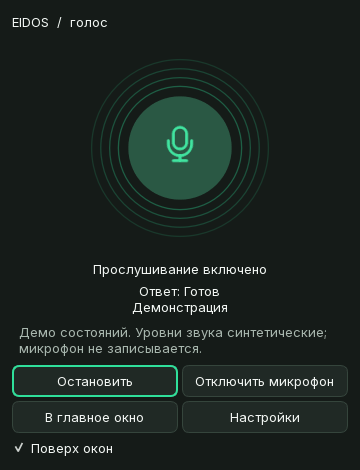

# Индикатор микрофона и анимация ответа

Обновлено 10 октября 2026 года. Перезапустите Eidos для загрузки изменений.

## Состояния

| Подпись | Реальное состояние | Индикация |
| --- | --- | --- |
| Прослушивание включено | Открыт обычный микрофонный поток, речевая активность ещё не началась | Зелёный микрофон, мягкая пульсация кольца |
| Жду: „Эйдос“ | Успешно открыт поток активации Porcupine | Более медленная спокойная пульсация |
| Слушаю вас | В обычном вводе обнаружено начало речи или активатор обнаружил ключевое слово | Волны от реального уровня микрофона |
| Микрофон выключен | Пользователь выключил голосовой ввод | Приглушённый круг, перечёркнутый микрофон, кольца неподвижны |
| Ошибка микрофона | Запуск или чтение устройства завершилось ошибкой | Неподвижные янтарные кольца и микрофон, описание ошибки |
| Микрофон не записывает | Поток закрыт; например, ввод готов к ручному запуску или воспроизводится ответ | Спокойный неподвижный индикатор без заявления о прослушивании |

Начальный этап «Открытие микрофона…» не включает зелёную пульсацию. Статус
подтверждается сигналом после успешного `InputStream.start()` / `RawInputStream.start()`.
Сигналы записи и активации обрабатываются в одном месте и обновляют главное окно
и мини-окно. При отключении ввод выключается визуально сразу; запоздавший сигнал
запуска не возвращает зелёную индикацию. Ошибка не исчезает от завершения задачи,
а после нового успешного запуска её описание очищается.

Кнопки «Отключить микрофон» / «Включить микрофон» показывают действие, а не
заявляют о работающем захвате, когда поток ещё не открыт.

## Отдельный статус ответа

Под статусом микрофона показан статус ответа: готов, обрабатываю, говорю или на
паузе. В мини-окне при озвучке двигаются пять звуковых полос внутри круга. Они
получают декодированные уровни настоящего плеера; при отсутствии уровня остаётся
небольшое спокойное движение. Оно не изображает активность микрофона.

На паузе ответа полосы неподвижны. Отключённый или неисправный микрофон не
блокирует озвучку: его кольца остаются неподвижными, а полосы ответа могут двигаться.
Кнопка центра по-прежнему запускает/завершает запись или ставит ответ на паузу и
продолжает его с той же позиции. Отмена и очередь речи работают по прежней схеме.

В мини-окне описание ошибки сокращается до первой строки; полный текст доступен
в подсказке и главном окне. Статус ответа остаётся виден даже при ошибке устройства.

## Анимации

Используются `QVariantAnimation`: переход цвета и размера кольца — 200 мс с
InOutCubic; пульсация — 2,8 секунды, ожидание слова — 4,2 секунды. Уровни звука
сглаживаются небольшим Qt-таймером. GUI не ждёт аудиозахват и не блокируется.
Пульсация не использует яркое свечение и резкие вспышки.

При выключении декоративных анимаций или включении сокращённых анимаций
останавливаются переходы, пульсация и сглаживание. Цвет, иконка и подпись сохраняются.
При скрытии индикатора его анимации также останавливаются. Внешние кольца ограничены
границами виджета, включая большую громкость микрофона.

## Проверки

- Полный набор: **189 passed**.
- `compileall` и `git diff --check` успешны; предупреждения Git касаются LF/CRLF.
- 11 новых тестовых случаев проверяют запуск/неудачу устройства, отсутствие
  ложного прослушивания на старте, синхронизацию, ожидание слова, отключение,
  поздние сигналы, сохранение ошибки, её очистку после восстановления,
  отключение анимаций и независимую озвучку/паузу в мини-окне.
- Реальный системный микрофон открыт: оба окна показали «Прослушивание включено».
  Через 0,35 секунды ввод отменён: оба окна перешли в `off`; пауза плеера не менялась.
- Несуществующее устройство: оба окна перешли в `error`, описание сохранилось
  после окончания задачи. В пробе звук не сохранялся, STT не запускался.
- Независимый обзор выявил и помог исправить остановку полос ответа при ошибке
  микрофона и сохранение старого сообщения после восстановления. Добавлены регрессии.

Исходные результаты: [реальное устройство](screenshots/voice-indicator/native-report.json),
[размеры снимков](screenshots/voice-indicator/metrics.json).
Мини-окно сохраняет размер **360×470 логических пикселей**.

Живой Porcupine с пользовательским ключом и моделью в этой проверке не запускался.
Границы передачи его состояний покрыты тестами с подменой устройства. Проверка
системного микрофона подтверждает открытие потока, а не качество речи в шумной комнате.

## Запись результата

Ниже настоящие Qt-виджеты; состояния и уровни в GIF поданы искусственно, без
записи микрофона. Продолжительность — 12,6 секунды.



[Главное окно](screenshots/voice-indicator/enabled-ready-main.png),
[ожидание слова](screenshots/voice-indicator/waiting-ready-main.png),
[мини-окно при озвучке](screenshots/voice-indicator/inactive-speaking-compact.png),
[выключенный ввод](screenshots/voice-indicator/off-ready-compact.png),
[ошибка](screenshots/voice-indicator/error-error-compact.png).

Для воспроизведения:

```powershell
& .\.venv\Scripts\python.exe -m pytest -q
& .\.venv\Scripts\python.exe scripts\capture_voice_indicator.py
& .\.venv\Scripts\python.exe scripts\verify_voice_indicator.py
```

Последний скрипт кратко открывает системный микрофон и отменяет запись до STT.
