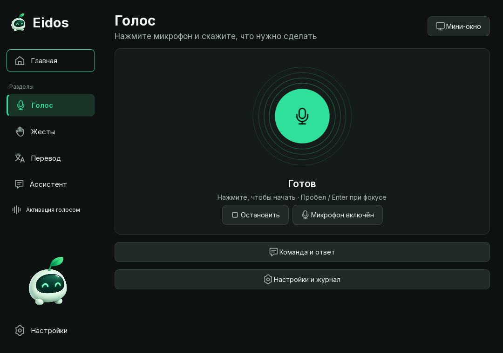
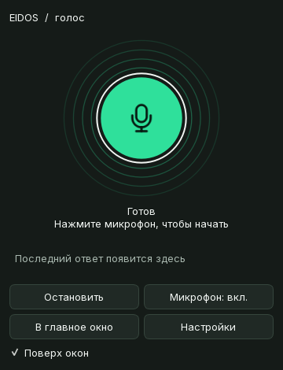
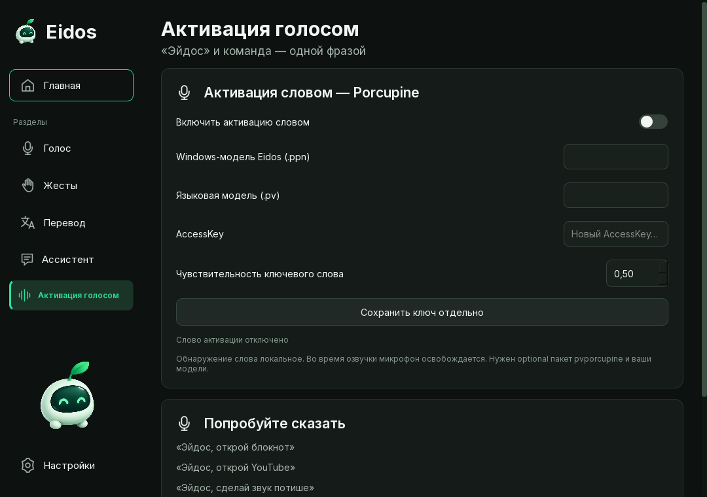
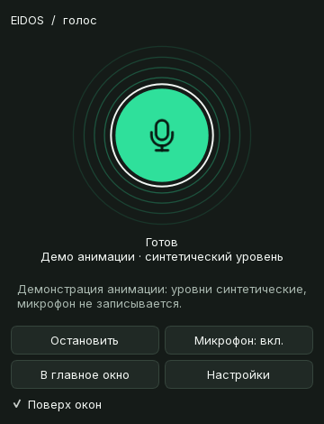

# Обновление голосового режима Eidos

Проверено 10 октября 2026 года, Windows, Python 3.11, PyQt6 / Qt 6.11.
После обновления файлов перезапустите Eidos. Уже запущенный экземпляр сам код не обновляет.

Последующее обновление разделяет статусы микрофона и ответа и уточняет подписи
индикатора. Актуальные состояния и анимация мини-окна — [voice-indicator.md](voice-indicator.md).

## Управление

Зелёный микрофон на странице «Голос» и в мини-окне выполняет одинаковые действия:

| Состояние | Нажатие на круг |
| --- | --- |
| Готов | Начать запись |
| Слушаю | Закончить запись и обработать команду |
| Обрабатываю | Кнопка временно недоступна |
| Говорю | Приостановить текущий файл |
| На паузе | Продолжить тот же файл с сохранённой позиции |

При фокусе работают Space и Enter, подсказка поясняет действие. «Остановить»
отменяет текущую задачу, выделение/перевод и очищает очередь речи. Уже выполненные
системные действия не откатываются. Отдельная кнопка микрофона выключает ввод;
она не ставит воспроизведение на паузу. Распознанный текст и ответ доступны в
«Команда и ответ», устройства и журнал — в «Настройки и журнал».

«Мини-окно» открывает отдельный виджет 360×470 логических пикселей. Перетаскивайте
его за верхнюю строку; «Поверх окон» управляет закреплением. Положение сохраняется
и ограничивается доступной областью монитора при смене экранов. Последний ответ
показан коротко, полный текст доступен в подсказке и главном окне.

## Активация и распознавание

«Активация голосом» — отдельная вкладка (Ctrl+7). Обычный ввод кнопкой работает
без ключа и моделей активации. Для Porcupine нужны ваш AccessKey, модель слова
«Эйдос» `.ppn` именно для Windows и соответствующая языковая модель `.pv`.
Сохраните ключ отдельной кнопкой, затем включите активацию и сохраните настройки.

После обнаружения слова запись продолжается в том же микрофонном потоке.
Кольцевой буфер сохраняет до 1,5 секунды перед обнаружением. Начало команды не
требует второй записи. Имя удаляется только в начале расшифровки; поддержаны
варианты «Эйдос», «Эйдус», «Эдос», «Айдос», Eidos и другие близкие варианты.
Если имя распознано плохо, допускается только известная точная команда;
непонятная фраза не передаётся агенту из режима активации.

В настройках доступны чувствительность речи 0…1 и лимит команды 5…120 секунд
(по умолчанию 30). Запись заканчивается после паузы; можно закончить её кругом.
Для тишины и низкой уверенности STT предлагается повторить запись. Применяются
адаптивный порог фонового шума и удаление постоянной составляющей сигнала, без
тяжёлого шумоподавляющего нейросетевого фильтра. Whisper получает подсказку
словаря с названием Eidos и основными командами.

Каждая запись имеет отдельный ID. Повторная доставка той же записи игнорируется,
но новая запись с теми же словами выполняется. Одинаковые слова внутри фразы
не удаляются. Команды блокнота, YouTube и громкости проходят через существующие
детерминированные инструменты и их разрешения.

Во время синтеза, проигрывания и паузы озвучки активация не слушает микрофон.
Звук начинается только после закрытия микрофонного потока; после окончания
остаётся защитная задержка 0,7 секунды. Это предотвращает прямую реакцию на
собственный вывод, но не обещает защиту от любого внешнего источника речи.

## Ответы, перевод и профили

В «Настройки» выберите нейтральный, дружелюбный или энергичный характер общения.
Он меняет формулировки и темп в рамках возможностей TTS. Имя берётся только из
выбранного профиля и используется изредка. Успех сообщается после проверенного
результата инструмента. Выбор Edge / Windows SAPI, голоса, скорости и громкости
сохранён; «Прослушать пример» использует текущие значения формы.

Фиктивных эмоциональных стилей провайдера нет. Речь делится на предложения и
проигрывается последовательно одним плеером. Режим «Краткие голосовые ответы»
сохраняет существующий выбор пользователя: при включении озвучиваются первые
три предложения. Команды чтения оригинала/перевода обходят этот режим. Защитные
границы очереди — 32 предложения и 24 000 символов: превышение отклоняется с
сообщением, без незаметного обрезания посреди речи.

«Переведи область экрана» вызывает существующий JonSnow: помощник скрывается,
появляется выделение, затем выполняются OCR и перевод, результат показывается
на странице перевода и в голосовом интерфейсе. Esc / правая кнопка отменяют
выделение; Stop отменяет текущую операцию. Оверлей помощника восстанавливается.
«Прочитай оригинал» и «Прочитай перевод» читают разные сохранённые результаты.
Предупреждение о возможной неточности появляется только при предоставленной
движком OCR уверенности ниже 60; Windows OCR без этой метрики её не выдумывает.

В настройках можно выбрать существующий профиль или ввести название нового и
переключиться. Настройки агента, память и отметка onboarding отдельны для каждого
профиля. Основной профиль сохраняет прежнее расположение данных. Завершение и
пропуск опроса сохраняются; повторное заполнение запускается вручную. Настройки
звука и интерфейса общие для приложения. Профиль выбирается вручную, биометрии нет.

## Результаты проверок

| Проверка | Фактический результат |
| --- | --- |
| Полный pytest | **178 passed in 14.80s** |
| Python compileall и git diff --check | Успешно; Git сообщает только нормализацию LF/CRLF |
| Пауза настоящего Qt-плеера | 640 мс, позиция стабильна, файл сохранён, продолжение с позиции |
| Уровни проигрываемого звука | Получены 63 события декодированного уровня через QAudioBufferOutput |
| Windows SAPI / Edge TTS | 250 490 / 37 584 байта, EndOfMedia, временные файлы удалены, ошибок нет |
| Настоящий Whisper base CPU/int8 | Синтетическая SAPI-фраза с именем и YouTube распознана чисто и с добавленным шумом |
| Повторения / тишина | «Да-да. Повтори-повтори.» сохранено; тишина отклонена |
| DPI 100 / 150 / 200% | Мини-окно 360×470 логических пикселей; изображения 360×470 / 540×705 / 720×940 |
| Отмена и состояния | Покрыты записи, пауза, очередь TTS, поздний ответ после Stop, отдельное отключение микрофона |
| JonSnow / onboarding / ID | Покрыты GUI bridge, чтение двух результатов, отмена, профили, пропуск и перезапуск опроса, дедупликация |

Независимый обзор дополнительно выявил и помог исправить недоступную кнопку паузы
при начале озвучки, поздний ответ после Stop, применение максимального лимита
записи и обновление параметров активатора. Для каждого добавлен тест регрессии.
Тесты изолируют хранилище ключей и не читают пользовательские секреты.

Исходные измерения: [Qt и TTS](screenshots/voice-upgrade/native-report.json),
[Whisper](screenshots/voice-upgrade/recognition-report.json),
[DPI 100%](screenshots/voice-upgrade/scale-1/metrics.json),
[150%](screenshots/voice-upgrade/scale-1-5/metrics.json),
[200%](screenshots/voice-upgrade/scale-2/metrics.json).

## Снимки и анимация

Снимки получены из настоящих Qt-виджетов с изолированной конфигурацией.
GIF демонстрирует состояния с искусственно поданными уровнями; он не является
записью микрофона. Реальные уровни плеера проверены отдельно в native-report.









## Ограничения

- На этой машине не проверено живое обнаружение Porcupine с пользовательским
  ключом и моделью. Передача команды из одного потока проверена подменённым
  устройством, а распознавание — настоящим Whisper на синтетических фразах.
- Живая запись на целевом микрофоне, реальные шумные комнаты и наложение голосов
  не проверены. Определения числа говорящих нет: подсказка «говорите по одному»
  не выводится по одной громкости. RMS-VAD и Whisper могут ошибаться в шуме.
- Эмоциональная манера ограничена текстом, пунктуацией и темпом; выразительный
  SSML-стиль не заявляется. Edge требует сеть; SAPI — установленные голоса Windows.
- Декодированные уровни доступны при поддержке QAudioBufferOutput установленным
  Qt. При его отсутствии сохраняется спокойная анимация, без выдуманных уровней.
- DPI проверен через Qt scale factor. Физическое отключение монитора во время
  живой сессии не воспроизводилось; обработчики экранов и ограничение положения
  реализованы. Нативные вызовы Whisper/OCR отменяются кооперативно после возврата.

## Воспроизведение проверок

```powershell
& .\.venv\Scripts\python.exe -m pytest -q
& .\.venv\Scripts\python.exe -m compileall -q eidos scripts
& .\.venv\Scripts\python.exe scripts\capture_voice_upgrade.py --scale 1
& .\.venv\Scripts\python.exe scripts\capture_voice_upgrade.py --scale 1.5
& .\.venv\Scripts\python.exe scripts\capture_voice_upgrade.py --scale 2
& .\.venv\Scripts\python.exe scripts\verify_voice_native.py
& .\.venv\Scripts\python.exe scripts\verify_voice_recognition.py
```

Последние два скрипта используют настоящий TTS/плеер и локальный кеш Whisper;
распознавание не выполняет системные команды. Для Edge нужен интернет.
